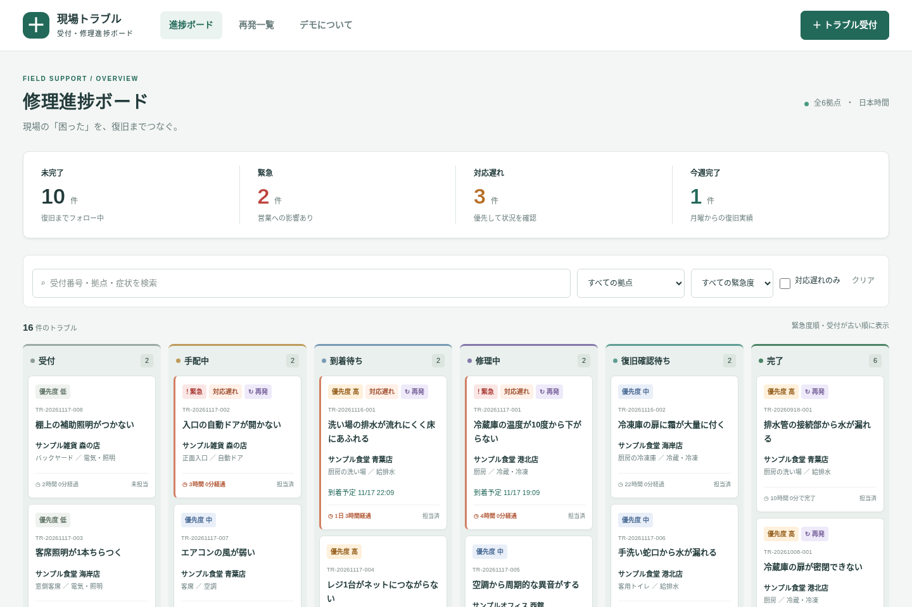

# 現場トラブル受付・修理進捗ボード

## 概要

複数拠点の設備トラブルを、現場での受付から本部の業者手配、修理、復旧確認まで追跡するデモアプリです。「起きたあと」の対応と経過時間の見える化に焦点を当てています。

## 主な機能

1. **トラブル受付（起票）**：拠点・場所・設備種別・症状・緊急度・架空の報告者名を入力。必須チェック、日本時間の日付による受付番号の自動採番、番号を表示する受付完了画面に対応しています。
2. **修理進捗ボード**：受付 → 手配中 → 到着待ち → 修理中 → 復旧確認待ち → 完了の6段階。スマホではステータスタブと縦並びカードで表示します。担当者・業者・到着予定・修理内容を編集し、進捗を進める／戻すことができます。到着待ち・修理中のカードにも到着予定を表示します。日時は日本時間で表示し、変更はタイムラインに記録。拠点・緊急度・対応遅れでの絞り込みとキーワード検索に対応しています。
3. **復旧確認と再発メモ**：復旧OKでは原因分類・対応内容・再発防止メモを必須で記録。「まだ不具合あり」では理由とともに修理中へ差し戻します。過去90日以内に同じ拠点×設備種別の受付が2件以上ある場合は再発バッジを表示し、再発一覧で件数・記録を確認できます。

対応遅れは未完了の緊急案件で2時間超、高の案件で24時間超の場合に表示。経過時間は30秒ごとに更新し、完了時に停止します。今週完了は日本時間の月曜0時以降の完了件数です。

## 画面一覧

| URL | 画面 |
| --- | --- |
| `/` | 件数サマリー・修理進捗ボード・絞り込み |
| `/new` | 受付フォーム・受付完了 |
| `/tickets/[id]` | 受付詳細・手配情報・ステータス変更・復旧確認・履歴 |
| `/recurrence` | 過去90日の再発一覧・再発防止メモ |
| `/about` | デモ説明・既定データへのリセット |

## 技術スタック

- Next.js 16（App Router、動的ルート対応。静的エクスポートは使用しません）
- React 19 / TypeScript
- Tailwind CSS 4 / カスタムCSS
- ESLint / ブラウザ localStorage
- 主要ロジック：`src/lib/tickets.ts`、相対日時のシード：`src/lib/seed.ts`

追加のnpmパッケージ、認証、外部API、データベース、外部フォントは使用していません。localStorageはクライアントのマウント後に読み込みます。

## 公開URL

https://field-trouble-repair-board.vercel.app

## スクリーンショット

| 画面 | 画像リンク |
| --- | --- |
| 進捗ボード | [01-board.png](docs/screenshots/01-board.png) |
| トラブル受付 | [02-new-ticket.png](docs/screenshots/02-new-ticket.png) |
| 受付詳細 | [03-ticket-detail.png](docs/screenshots/03-ticket-detail.png) |
| 復旧確認 | [04-recovery-check.png](docs/screenshots/04-recovery-check.png) |
| 再発一覧 | [05-recurrence.png](docs/screenshots/05-recurrence.png) |

04はスマホ幅（390px）、それ以外はデスクトップ幅（1440px）で、公開URLを撮影しています。



## ローカル起動方法

Node.js 20.9以上を利用してください（検証環境：Node.js 24）。

```bash
npm install
npm run dev
```

ブラウザで http://localhost:3000 を開きます。

```bash
npm run lint
npm run typecheck
npm test
npm run build
npm start
```

主要ロジックの境界値テストはNode.js 22.18以上で実行できます。

```bash
npm test
```

## デモデータについて

初回アクセス時に6拠点・16件のトラブルを現在時刻からの相対日時で生成します。全ステータスに分布し、生成時点で対応遅れ3件・再発3組を含みます。再発組には40・60・75日前の完了案件があり、原因と再発防止メモは個別に記録しています。会社・店舗・人名・業者・トラブルはすべて架空であり、実在の企業・個人とは無関係です。電話番号・メールアドレスは掲載していません。

データはブラウザのlocalStorage（`ftrb:v1`）にのみ保存されます。ページの再読み込み後も残りますが、別の端末・ブラウザとは共有されません。ブラウザの保存データを消すと記録も失われます。同じブラウザの別タブでの変更は保存イベントで反映されますが、同時編集の競合解決を備えた本番システムではありません。

`/about` の「既定データに戻す」で、確認後に追加・変更した記録を削除し、現在時刻でシードを再生成できます。保存失敗時は画面にエラーを表示します。実在する個人情報は入力しないでください。
